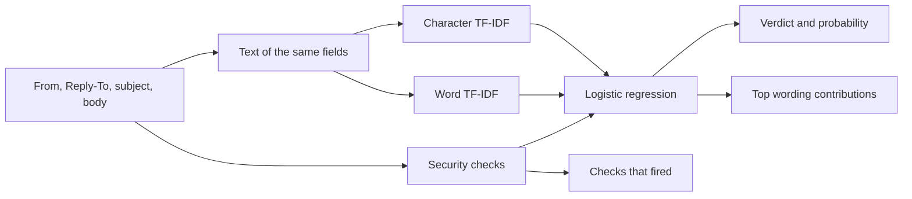

# PhishLens

PhishLens is a local email classifier for Om, a cybersecurity and AI student who wants a project that is both a study tool and a demo. Paste a message. The app says **phishing** or **legitimate**, gives a probability, and shows two kinds of evidence: security checks a person can audit, and the words a linear model actually weighed.

It is a defensive learning project. It does not send mail, open links, or help anyone write a lure. The mailbox it trains on is fiction.

## Ethics, first

Use this on mail you are allowed to read: your own messages, a class dataset, or a range you were asked to review. Do not use it to write, send, or improve phishing. The sample "phishing" rows are obvious classroom caricatures on reserved domains and documentation IP addresses. They exist so a detector has something to detect. They are not templates.

A score is not a reason to click, reply, pay, or reset a password. If a real message worries you, use the account page you already know how to reach, or your school's help desk. Do not use the link in the message.

## Portfolio pitch

The interesting part of detection is not a black-box label. A defender has to say *what* looked wrong: the sender's domain, the link, the ask. PhishLens makes that split explicit.

- Handcrafted checks cover the security ideas from an intro course: raw IP links, shortener-style hosts, abused top-level domains, lookalike and mismatched brands, reply-to mismatches, free mailboxes claiming to be an organization, urgency, password or payment asks, and a few HTML hints.
- A TF-IDF vectorizer (word unigrams and bigrams, plus character n-grams) reads the sender, reply-to, subject, and body.
- Logistic regression adds those views together. The weight on each feature is a number you can read. Positive weights lean phishing. Contribution on a single email is **value times weight**.

That is why the model is linear on purpose. A more opaque model would score higher on a leaderboard and teach less in a demo.

## How a decision is made



The label column never enters the text. Category names such as `invoice_payment` are withheld for the same reason: the model should not be able to read the answer key.

Security checks live in `src/features.py`. A few design choices are worth knowing before you trust a flag:

- Credential and payment checks look for a **request** ("enter your password", "overdue invoice"), not the bare word. A campus note that says staff will not ask for a password does not trip the check.
- "Urgent" is a flag, and it is also allowed in real facilities mail, so the word alone does not decide.
- Lookalikes use leet substitutions (`micr0soft`), a one-character edit, or a compound such as `paypal-secure`. Short names skip the fuzzy comparisons so ordinary words are not accused of impersonating `irs`.
- Reply-To is compared on the registered domain. `cs.northwind.edu` answering as `northwind.edu` is the same school.
- Links are strings. Nothing is fetched.

The checks are deliberately simple. Subdomains of a trusted domain are treated as trusted. Full Unicode homoglyphs are not. HTML is a handful of regular expressions, not a browser.

## What the demo is for

The Streamlit page loads ten synthetic examples.

- Five caricatures: a suspended-account note, an invoice, a gift-card prize, a help desk on a free mailbox, and a quieter lookalike sign-in.
- Four ordinary messages: a class announcement, a bookstore receipt, a calm IT reminder, and a facilities note that really does say "urgent".
- One intentional miss, **Quoted in class**. A professor at `northwind.edu` quotes a fake message for Thursday's reading. The classroom label is legitimate. The model calls it phishing, because the quoted sentences still say "verify your account" and "enter your password". Bag-of-words features cannot see the quotation marks. That failure is the point of the button.

Northwind University, Harbor Credit Union, and Cedar Books are fictional. Well-known brand names appear only inside those caricatures, on hosts such as `paypa1-secure.example`.

## Setup

Python 3.11 or 3.12. From the repository root:

```bash
python3 -m venv .venv
source .venv/bin/activate
pip install -r requirements.txt
```

The trained pipeline is already in `models/pipeline.joblib`, so you can demo without training. Train again if you change the data or the features:

```bash
python -m src.dataset   # rewrite data/sample_emails.csv, seed 42
python -m src.train     # fit, evaluate, save model and metrics
```

Run the tests and the app:

```bash
python -m pytest
streamlit run src/app.py
```

The app binds to port **8765** (see `.streamlit/config.toml`). Open [http://127.0.0.1:8765](http://127.0.0.1:8765). Classification stays in this process. Nothing is uploaded.

## Command line

Score a built-in example:

```bash
python -m src.predict --demo suspension
python -m src.predict --demo facilities
python -m src.predict --demo quoted-homework --json
```

Score a pasted message. Headers are optional. A blank line ends the header block.

```bash
python -m src.predict --file message.txt
```

```text
From: Northwind IT <it-news@northwind.edu>
Reply-To: it-news@cs.northwind.edu
Subject: Account reminder from Northwind IT

Staff will not ask you to send a password by email.
The campus page is https://accounts.northwind.edu.
```

Or pass the fields directly:

```bash
python -m src.predict \
  --sender "Prof. Ada Okonkwo <aokonkwo@northwind.edu>" \
  --subject "CS 484 office hours Thursday" \
  --body "Thursday 14:00-16:00 in Room 210. Homework is on https://canvas.northwind.edu/courses/484."
```

Demo ids: `suspension`, `invoice`, `prize`, `helpdesk`, `lookalike`, `class-note`, `receipt`, `security-reminder`, `facilities`, `quoted-homework`.

## Held-out scores

These numbers are from the committed training run (`models/metrics.json`).

The mailbox has **560** synthetic emails, **280** legitimate and **280** phishing. Training used a stratified 75/25 split, seed **42**: **420** train rows, **140** test rows. The positive class is phishing.

| | Precision | Recall | F1 |
| --- | ---: | ---: | ---: |
| Phishing | 1.000 | 1.000 | 1.000 |
| Legitimate | 1.000 | 1.000 | 1.000 |

Accuracy on that split is **1.000**.

Confusion matrix. Rows are the truth, columns are the prediction.

|  | Predicted legitimate | Predicted phishing |
| --- | ---: | ---: |
| True legitimate | 70 | 0 |
| True phishing | 0 | 70 |

**Do not read this as production accuracy.** The teaching set was built so every phishing row carries an obvious signal, and the two classes barely overlap. A perfect score here means the split was separable. It does not mean the model is ready for a real inbox. The quoted-homework example is already enough to break it, and that message is not in the training file.

### What the weights learned

Security-feature weights from this fit. Positive leans phishing when the check is on. `url_count` is negative: campus mail is full of ordinary links, so "has several URLs" is not a phishing signal in this mailbox. The IP, shortener, and uncommon-suffix checks carry that idea instead.

| Feature | Weight |
| --- | ---: |
| credential_request | +1.945 |
| brand_impersonation | +1.824 |
| reply_to_mismatch | +1.493 |
| suspicious_tld_count | +1.129 |
| payment_request | +1.117 |
| urgency_hits | +1.007 |
| lookalike_domain | +0.946 |
| ip_url_count | +0.537 |
| html_password_input | +0.341 |
| subject_excess_caps | +0.220 |
| subject_excess_punct | +0.220 |
| html_form | +0.181 |
| link_text_mismatch | +0.178 |
| shortener_count | +0.151 |
| freemail_org_claim | +0.143 |
| url_userinfo | +0.074 |
| html_script | +0.024 |
| url_count | −0.569 |

The largest word weights tell the same story, with one corpus artifact called out below.

Toward phishing: `invoice` (+0.157), `example` (+0.145), `payment` (+0.135), `confirm` (+0.120), `your password` (+0.109), `verify` (+0.109), `secure` (+0.103), `login` (+0.100).

Toward legitimate: `northwind edu` (−0.315), `edu` (−0.315), `facilities` (−0.145), `room` (−0.136), `hi` (−0.123), `news` (−0.123).

`example` ranks high because the caricatures use the reserved `.example` suffix and most campus mail uses `.edu`. That is a property of this teaching set, not a rule to deploy. Function words such as `the` and `in` also pick up a legitimate lean, because ordinary mail is full of them. The demo hides the noisiest of those in the cue list. The model still sees them.

A security check and a word can disagree. Urgency has a positive weight, but the bare token can point the other way once the check has already accounted for it. Read the checks and the wording together.

## Layout

```text
data/sample_emails.csv     560 labeled teaching emails
data/demo_emails.json      examples the app and CLI can load
src/features.py            parsing and security checks
src/dataset.py             deterministic generator, seed 42
src/pipeline.py            TF-IDF + logistic regression, and explanations
src/train.py               split, fit, metrics, save
src/predict.py             classify one email
src/app.py                 Streamlit demo
models/pipeline.joblib     fitted pipeline
models/metrics.json        the table above
tests/                     feature checks, dataset audit, demo expectations
```

CSV columns: `email_id`, `sender`, `reply_to`, `subject`, `body`, `label` (1 phishing, 0 legitimate), `category`. Only the four text fields are model inputs.

Regenerate the CSV with `python -m src.dataset`. The generator checks its own work: every phishing row must trip a strong signal, and ordinary legitimate rows must stay quiet. Facilities notes are the exception. They are allowed to say "urgent".

## Limitations

- The training mail is synthetic and easy. Real phishing is shorter, more personal, and written to avoid the phrases in a public teaching set. These probabilities are sharp because the classes were built to separate. Treat them as a ranking on this demo, not as a calibrated risk.
- The model does not look at SPF, DKIM, DMARC, received hops, attachments, images, or the reputation of a live domain. Text inside a picture is invisible to it.
- Quoting, forwarding, or discussing a malicious message can make a real email look like the thing it describes. The **Quoted in class** button is that failure.
- Lookalike detection is leet-speak, a single edit, and a short list of compounds. It will miss homoglyphs and brands that are not in the list in `src/features.py`.
- Any subdomain of a domain on that list is treated as official. That is a simplification.
- A handcrafted list of TLDs and shorteners is a teaching list. It will go stale, and it will flag some legitimate hosts.
- False positives bury real mail. False negatives miss an attack. Either one is a reason to keep a person in the loop. This is not a secure email gateway and it should not be dropped in front of a mailbox as one.

## Tests

```bash
python -m pytest
```

The suite checks the security rules (including a few lookalike traps, such as a pineapple stand that is not Apple), the shape and balance of the CSV, and the saved model's verdict on every demo example. Clear caricatures must score as phishing. Ordinary campus mail, including the urgent repair, must score as legitimate. The quoted homework must score as phishing and must show the credential and urgency checks, so that known miss cannot silently flip.
